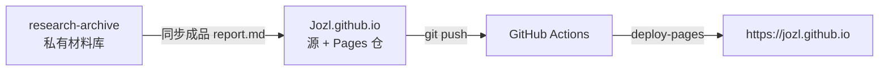

# 把站点发布迁到 GitHub Actions

## 起因

一直缺一个地方放「调研」：过程笔记、来源台账、爬下来的摘录，一堆东西直接塞进博客仓会把发布仓撑胖，而且大部分内容不适合公开。

干脆借这个机会把整条发布链路重做一遍：材料归材料，成品归成品，发布交给 GitHub Actions。

## 开工前先摸家底

一查才发现，手上同时存在三份「站点相关」的东西：

| 位置 | 是什么 | 当时的角色 |
| --- | --- | --- |
| `Jozl/Jozl.github.io`（公开） | 构建产物 | 线上站的唯一来源 |
| 一个 Hexo 源工程 | 从产物反推重建出来的 | 已归档，只作对照 |
| `Jozl/blog`（私有） | VitePress 源 | 真正在用的源 |

问题有三个：

1. 产物仓每次靠本地脚本 `git init` 之后强制推送，历史被反复抹掉，推错一版就回不去。
2. 发布要在本机手搓，还要临时注入凭据。
3. 源和产物分在两个仓，改完得记得「先构建再推产物」，漏一步就线上线下不一致。

## 一、材料与成品分开

调研的产物天然分两档：

- **过程**：笔记、来源清单、原文摘录、走错路的记录 —— 只进私有材料库。
- **成品**：提炼过的结论 —— 才发到站上。

于是新增一个私有材料仓，每个调研项目一个目录，里面有 `meta.yml`（阶段、时间、分类）、`sources/index.md`（编号 S1、S2… 的来源台账）、`notes/`（一天一篇）和最终的 `report.md`。原始 PDF、网页快照这类大件只留本地，不进 git。

站上只放同步后的成品：一个脚本读 `meta.yml` 和 `report.md`，生成带 frontmatter 和「阶段状态卡」的 Markdown，落到 `docs/research/<slug>/`。

## 二、把发布搬进 Actions

把 VitePress 源整体并进 `Jozl.github.io` 仓，Pages 的构建方式从「从分支发布」切成「GitHub Actions」。

工作流就六步：

```yaml
- checkout
- setup-node（带 npm 缓存）
- npm ci
- vitepress build
- 上传 docs/.vitepress/dist 为 Pages artifact
- deploy-pages 发布
```

切完之后：

- 仓库里只剩源，构建产物不再提交；
- 每次部署在 Actions 里有记录，可以回滚到任意一次；
- 再也没有 `git init` + 强推。

## 三、清掉旧产物

产物文件早就不该待在仓里，一口气删了 58 个：HTML、`assets/`、字体、哈希清单……仓库顶层从二十多项缩到七项：`.github`、`.gitignore`、`README.md`、`docs`、`package.json`、`package-lock.json`、`scripts`。

旧的手搓发布脚本也从两个仓里删掉了。

## 踩到的坑

**1. 推送到一半，GitHub 的 git 协议连不上**

`github.com:443` 直接超时，但 `api.github.com` 正常。于是改用 GitHub 的 Git Data API：把要提交的文件逐个上传成 blob，拼一棵 tree，造一个 commit，再更新分支引用。等网络恢复后本地再 `fetch + reset` 对齐。

**2. 切换 Pages 模式有短暂空窗**

「从分支发布」切到「Actions」之后，要等第一次工作流跑完站点才回来。所以顺序是：先切模式，立刻推代码触发构建，而不是反过来。

**3. 强推会抹掉历史**

旧脚本每次都 `git init` 一个新仓再 `push -f`，产物仓永远只剩一个提交。改成增量提交或 Actions 之后，历史才留得住——想回滚才有东西可回。

## 几个仓库，各管什么

这是这次改造之后的分工，也是以后照着用的地图：



| 仓库 | 可见性 | 角色 | 现在还要改它吗 |
| --- | --- | --- | --- |
| `Jozl.github.io` | 公开 | 站点源 + Pages 仓，push 触发 Actions | 日常会改 |
| `research-archive` | 私有 | 调研材料库：笔记、来源台账、成品草稿 | 调研时改 |
| `Jozl/blog` | 私有 | 旧的 VitePress 源，已退役 | 不再改 |
| Hexo 源工程 | — | 旧站的对照，遗骸收在 `research-archive` 里 | 只读 |

一句话记法：**过程进私有材料库，成品进公开站源，push 即发布。**

## 现在的发布流程

```bash
cd ~/Jozl.github.io
git add -A && git commit -m "post: 文章标题" && git push origin master
```

推完约一分钟上线，部署记录留在 Actions 里。再也不用碰凭据，也不用在本地跑构建。

## 以后

调研项目按阶段发布：立项、证据、对抗、定稿，每个节点发一次，原地修订。每篇都是阶段稿，结论可能会变——这不是偷懒，是想让「正在想什么」也留下痕迹。
